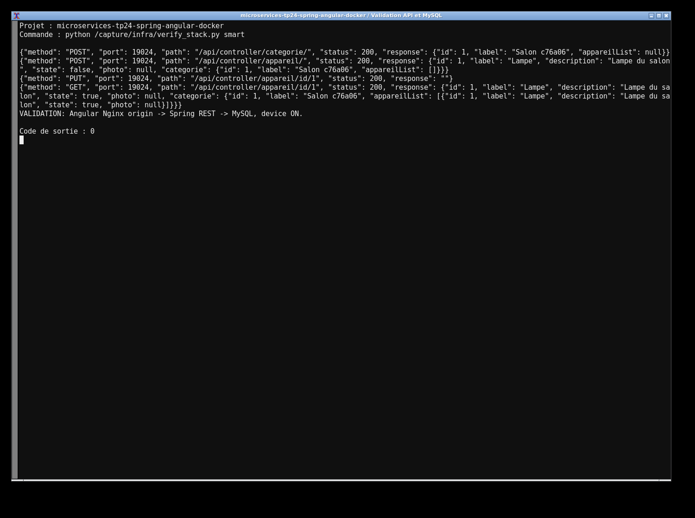
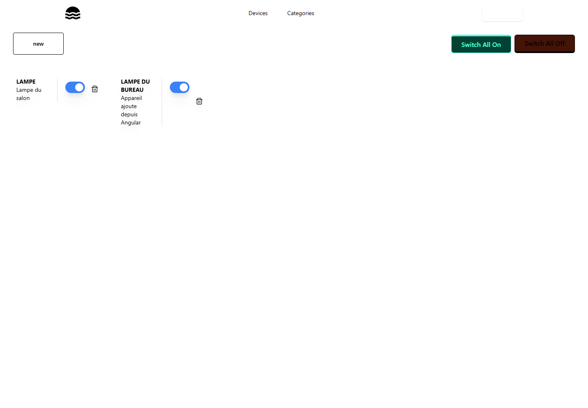
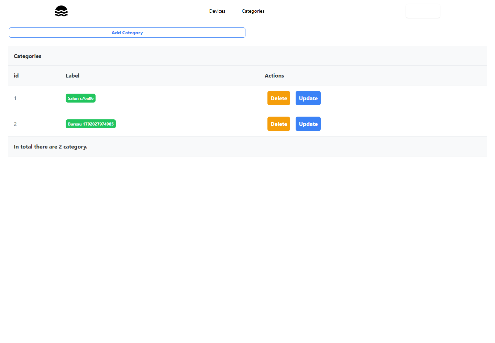
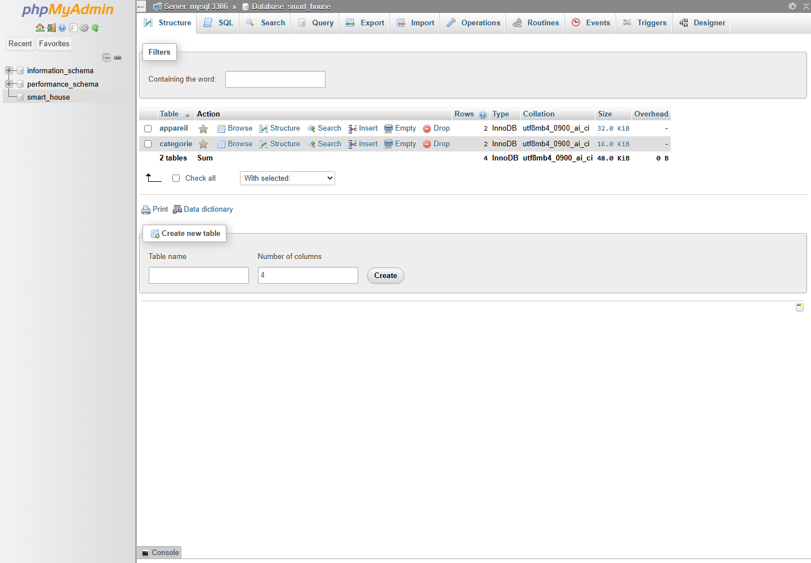

# TP24 — Smart Home dans Docker

 J'ai repris le projet [smarthouse de Lachgar](https://github.com/lachgar/smarthouse) demandé dans le TP. Le backend Spring Boot et le frontend Angular ont chacun leur build multi-stage. Nginx sert Angular et transmet `/api` au backend. Le navigateur utilise donc la même origine, sans adresse localhost codée en dur dans Angular.

 ```sh
 mvn -f Smart_Home_back/pom.xml clean verify
 docker compose up -d --build
 docker compose ps
 ```

 L'application est sur `http://localhost:19024`, l'API sur `18024` et phpMyAdmin sur `19124`. MySQL attend d'être prêt avant le backend et conserve ses données dans un volume. Les ports hôtes ont été décalés pour éviter les conflits. Le frontend garde Angular 14 du projet initial et utilise Node 16 uniquement pendant le build. Pour arrêter les services : `docker compose down`.

 Les traces d'exécution sont dans `evidence/` et les captures dans `screenshots/`.

 






